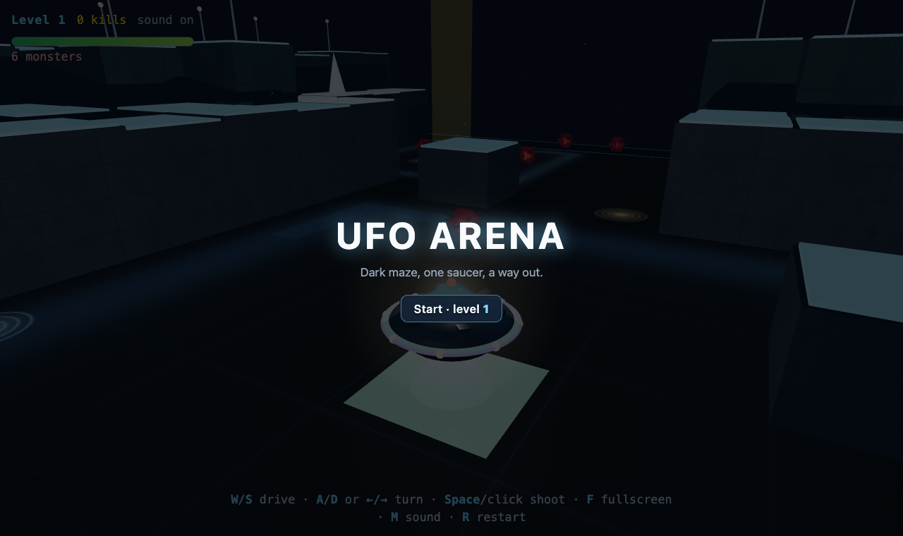
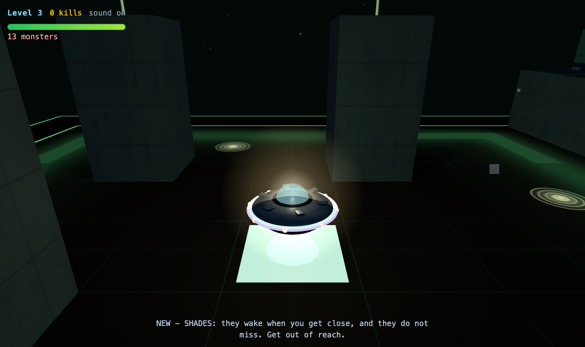
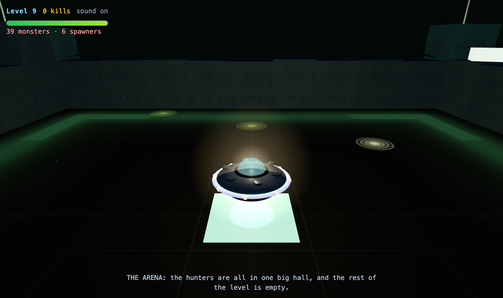
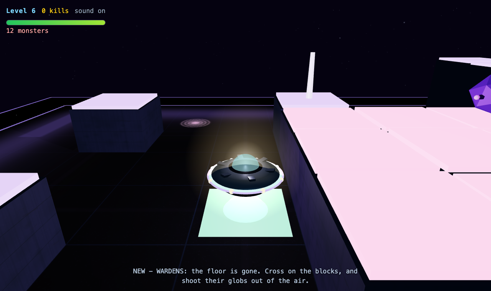
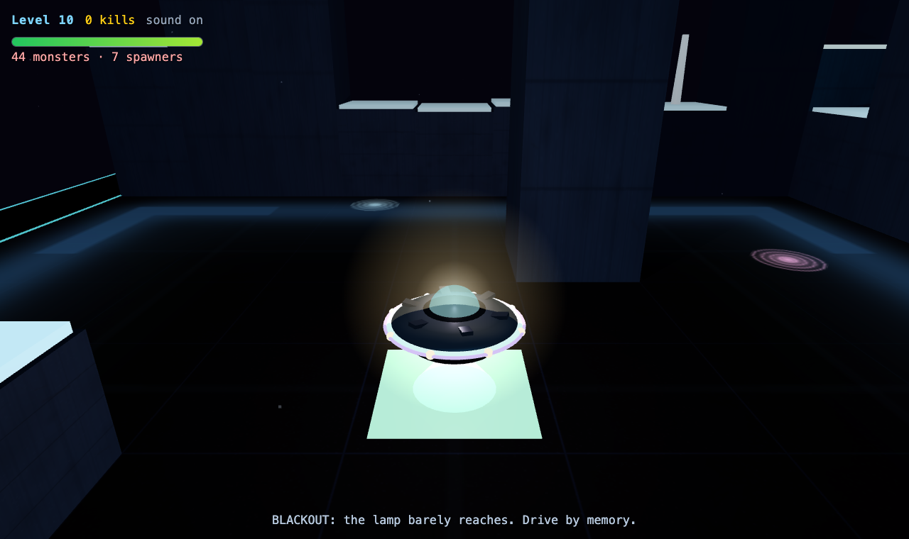

# UFO Arena

A dark top-down 3D maze in the browser. You fly one saucer through levels that are
almost entirely black: **you only see what the lamp reaches.** Monsters, mines and
spawners are out there, the floor has holes in it, and there is exactly one way out.

**Play it: <https://marcoklein.github.io/ufo-arena-vibe/>**



## What it is

- **One saucer, one lamp.** A short-reach lamp and a little ambient light: walls and
  monsters appear out of the dark as you come up on them.
- **Two levels per map.** Lift pads take you up onto the blocks; up there the blocks
  are a road and the holes cost hover fuel. Holes are simply *missing ground* — no
  floor, no artwork, just the lip of the opening.
- **Monsters that never change.** A hunter is a hunter on level 1 and on level 40:
  same hp, same speed, same rate. Difficulty comes from the level's *shape* — open
  halls, monolith thickets, warrens, tunnels, blackouts — not from inflating stats.
- **Things that shoot back, and things you can shoot.** Wardens lob heavy exploding
  globs (shoot them out of the air), spitters charge up a visible chamber before they
  fire, and the rings that spawn monsters can be shot down and closed for good.
- **Endless levels with character.** Level 1–10 teach one idea each, then five
  "places" cycle — the floor-is-gone level, the warren, the roofed-in tunnels, the
  arena, the blackout — with their own palette, props and lighting.
- **Progress saved in the browser.** The start screen offers *Continue* at your
  highest level or a *New game*; the best level only ever goes up.
- **Sound synthesised at runtime.** No audio files — everything is generated by
  `audio.js`.
- **No build step.** `index.html` plus ES modules, three.js `0.186.1` from a CDN via
  an import map.

## Controls

| Key | |
| --- | --- |
| `W` / `S` | drive forward / back |
| `A` / `D` or `←` / `→` | turn |
| `Space` or click | shoot |
| `R` | restart the level |
| `M` | sound on/off |
| `F` | fullscreen |
| `Enter` / `N` | on the start screen: continue / new game |

## Levels

| Level | | |
| --- | --- | --- |
| 1 | mines, two rooms | 6 | **the floor is gone** — cross on the blocks, wardens on the deck |
| 2 | spitters | 7 | the warren: tight cells, no halls |
| 3 | shades: they wake when you get close | 8 | roofed in: the level above closes over every corridor |
| 4 | lift pads: one level up | 9 | the arena: every hunter in one hall |
| 5 | spawners: shoot the rings down | 10 | blackout: the lamp barely reaches |

From level 11 the places cycle, and the monster count settles rather than climbing
forever.






## Running it locally

ES modules do not load over `file://`, so serve the folder:

```sh
python3 -m http.server 8000 --bind 127.0.0.1
# then open http://127.0.0.1:8000
```

## Tests

The game is written so the maze, the save file and the gameplay rules can be tested
without a browser:

```sh
node test.mjs                                        # maze, holes, vaults, save (244 checks)
node --import ./smoke/loader.mjs smoke/run.mjs       # gameplay, headless (368 checks)
node smoke/audio.mjs                                 # the synthesised sound
node smoke/shot.mjs smoke/out/shot.png "&pose=tour"  # render one frame to a PNG
```

`smoke/` holds the harness: a three.js stub, a headless loader, a browser probe page
with camera poses and a screenshot tool. `smoke/README.md` documents the design rules
that the tests enforce — among them *monsters never change properties per level* and
*a hole is a hole*.

## Files

| File | |
| --- | --- |
| `index.html` | page, HUD, start screen, import map |
| `main.js` | the game: craft, monsters, rifts, mines, lifts, levels, palettes |
| `maze.js` | maze generation, the two-level layout, collision |
| `audio.js` | synthesised sound effects and music |
| `themes.js` | room themes |
| `save.js` | the save file (localStorage, with a memory fallback) |
| `test.mjs`, `smoke/` | the test suites and the headless harness |
| `PLAN.md` | the original plan for the project (it still calls the craft a *sphere*; the game grew past it) |
| `PLAN-multiplayer.md` | the plan for co-op multiplayer (WebSocket first, WebRTC later) and the co-op rules |

## Licence

None yet — all rights reserved by default. If you want to reuse this, say so and a
licence can be added.
